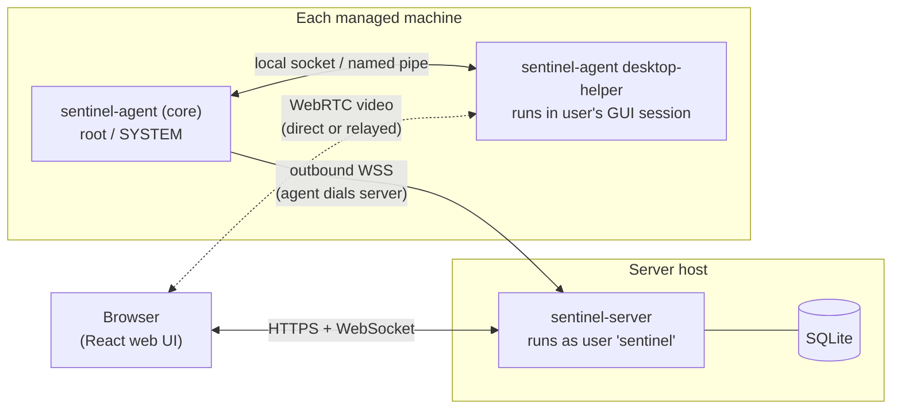

# Architecture

A short, friendly tour of how Sentinel fits together. Each part says whether it exists yet.

## The two programs

Sentinel is two binaries built from this one repository:

- **`sentinel-server`** is the only part with an open network port. It serves the web UI and
  the HTTP API, owns the database, and relays terminal, file and remote desktop traffic
  between browsers and agents.
- **`sentinel-agent`** runs on every managed machine. It connects **out** to the server and
  keeps that connection open. It never listens on a network port, so managed machines need
  no firewall changes and work behind NAT.

You expose the server's one port however you like: directly, or behind Caddy, nginx,
Traefik, Cloudflare Tunnel, Tailscale and so on.

## Who runs as what

| Component | Runs as | Why |
|---|---|---|
| `sentinel-server` | An unprivileged `sentinel` user | It only serves the UI and API and relays traffic |
| `sentinel-agent` | root (Linux, macOS) or SYSTEM (Windows) | Storage, Docker, services, packages, power and files need it |
| `sentinel-agent desktop-helper` | Inside the logged-in user's GUI session | Screen capture and input have to happen there |

A **policy file** on each machine, owned by root, can switch off any capability. The server
can't change it, which limits what a compromised server can do.

## How agents prove who they are

Many reverse proxies and tunnels end TLS before traffic reaches the server, which strips
client certificates. So instead of mutual TLS, the agent and server prove their identities
**inside** the WebSocket connection by signing random challenges with Ed25519 keys:

1. The agent says hello with its ID and a random nonce.
2. The server signs both nonces with its key; the agent checks the signature against the
   server key it saved when it enrolled.
3. The agent signs both nonces with its own key; the server checks it against the agent's
   stored public key.
4. Only then does the server send `welcome`.

This works through any proxy and lets the agent detect an impostor server even when someone
else terminates TLS.

## How a request flows

"Restart container X on machine Y":

1. The browser calls `POST /api/agents/{agentID}/docker/containers/{containerID}/restart`.
2. The server checks the session and the user's role, and records an audit entry.
3. The server sends a `docker.container.restart` request to the agent over its WebSocket.
4. The agent checks its policy file, restarts the container, and replies with the same
   request ID.
5. The server returns the result to the browser and records the outcome in the audit log.

Messages are JSON with a `type`, an `id`, an `action` like `docker.container.restart` and a
`payload`. Terminal sessions and file transfers use **streams**: binary frames tagged with a
4-byte stream ID, which the server relays without looking inside.

## Where the code lives

| Path | What's there | Status |
|---|---|---|
| `cmd/sentinel-server/` | Server entry point: parses flags, wires packages together | Serves the web UI |
| `cmd/sentinel-agent/` | Agent entry point and subcommands | `version` only |
| `internal/server/config/` | Reads and validates `server.toml` | Built |
| `internal/server/servertls/` | Self-signed and ACME certificates | Built |
| `internal/server/middleware/` | Security headers, trusted proxies, Origin check, base path | Built |
| `internal/server/app/` | Assembles the database, services, routes and middleware | Built |
| `internal/server/api/` | HTTP handlers and the router | Setup, sign-in, sessions, users, audit log |
| `internal/server/httpserver/` | Opens the listening socket and serves HTTP | Built |
| `internal/server/store/` | SQLite connection, transactions, single writer, migrations | Built |
| `internal/server/auth/` | Setup token, passwords, TOTP, recovery codes, sessions, rate limiting, roles | Built |
| `internal/server/localaccess/` | Checks who may run `reset-admin` on the server host | Built |
| `internal/server/audit/` | Append-only, hash-chained audit log; verify and export | Built |
| `internal/server/secrets/` | Encrypts stored secrets with the key in `secret.key` | Built |
| `internal/server/serverkey/` | The server's Ed25519 identity key and its fingerprint | Built |
| `internal/server/fleet/` | Enrollment tokens and the list of managed machines | Built |
| `internal/server/hub/` | The agents' WebSocket endpoint: handshake, heartbeat, requests, online status | Built |
| `internal/server/metrics/` | Stores metric samples, rolls them up and answers chart queries | Built |
| `internal/server/scheduler/` | Runs periodic jobs (metric rollups and cleanup) | Built |
| `internal/server/web/` | Embeds the built React app into the server binary | Built |
| `internal/shared/buildinfo/` | Version string shared by both binaries | Built |
| `internal/shared/clock/` | The real clock and its timers; tests use `internal/testutil/fakeclock` | Built |
| `internal/shared/keyfile/` | Key files only their owner can read | Built |
| `internal/testutil/` | Helpers used only by tests | Built |
| `internal/protocol/` | Message types, frames and handshake signatures shared by server and agent | Built |
| `internal/server/{relay,alerts}/` | The rest of the server | Planned |
| `internal/agent/<feature>/` | One package per agent feature (terminal, docker, zfs, ...) | Planned |
| `web/` | The React web UI | Setup, sign-in, account, audit log |
| `scripts/` | Dev and CI helper scripts | Built |
| `docs/decisions/` | Why things are the way they are | Ongoing |

Rule of thumb: to change feature X, look in `internal/agent/X/` (agent side),
`internal/server/api/X.go` (server side) and `web/src/pages/X/` (UI).

## How the web UI gets into the server

`make web` builds the React app with Vite and copies the output into
`internal/server/web/dist/`. The Go compiler embeds that folder into `sentinel-server`, so a
release is one file. During development, `make dev` also runs Vite's own server with hot
reload, which forwards API calls to the Go server
([ADR 0003](decisions/0003-embedding-the-web-ui.md)).
